 

---

## 🧭 Now

- 🎓 B.Tech CSE, Alliance University (since Jul 2024)
- 🌍 **Campus Lead**, Open Source Connect India (Sep 2026 – present)
- 💡 **Innovation Ambassador**, Institution's Innovation Council (Jun 2026 – present)
- 🌐 **President**, Cisco Networking Academy, Alliance University
- 🔭 Exploring LLM agents, RAG, computer vision, and MLOps

## 🧰 Stack

## 🚀 Featured Work

| Project | What it does | Stack |
|---|---|---|
| [**Library_DBMS**](https://github.com/ShibilAhamed701212/Library_DBMS) | Library system with admin/member portals, live chat, gamification and AI book discovery | Flask · MySQL · Socket.IO |
| [**LeaseGuardAI**](https://github.com/ShibilAhamed701212/LeaseGuardAI-Agent) | Lease analyzer: OCR, Gemini risk extraction, fairness scoring, negotiation assistant | React · TypeScript · Redis · PostgreSQL |
| [**VerifyIQ**](https://github.com/ShibilAhamed701212/verifyiq-ai-claim-verification) | Multimodal claim verification; a vision model extracts facts, deterministic rules decide | FastAPI · Docker · OCR |
| [**Price Predictor**](https://github.com/ShibilAhamed701212/Price-Predictor-System) | End-to-end MLOps pipeline with ZenML pipelines and MLflow tracking | Python · ZenML · MLflow |
| [**Climate Digital Twin**](https://github.com/ShibilAhamed701212/climate_digital_twin) | India climate simulation with ensemble forecasts and risk assessment | Python · Streamlit |
| [**Offline Face Auth**](https://github.com/OpenForgeStack/react-native-offline-face-auth) | On-device ArcFace recognition with liveness detection, built for low-resource phones | React Native · ONNX |
| [**voice-to-shop**](https://github.com/ShibilAhamed701212/voice-to-shop) | Voice-first home-service booking that never double-books a slot | AI agent · Node |
| [**LAM-Diffusion**](https://github.com/ShibilAhamed701212/lam-diffusion) | Anime image synthesis: Large Action Model planner feeding latent diffusion | Python · Diffusion |

## 🏅 Certifications

`AWS Fundamentals Specialization` · `Natural Disaster & Climate Risk Specialization` · `IBM Cloud Fundamentals` · `Microsoft Azure Storage` · `55+ Coursera certificates in AI/ML, cloud and CS` · [Full list →](https://www.coursera.org/account/accomplishments/certificates)

## 📊 GitHub

---

**Open to AI/ML engineering internships and roles** · [shibilahamed701212@gmail.com](mailto:shibilahamed701212@gmail.com)

